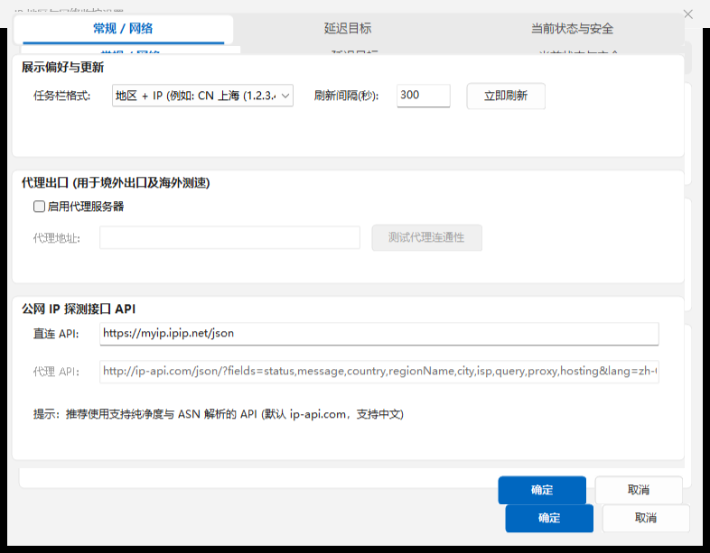
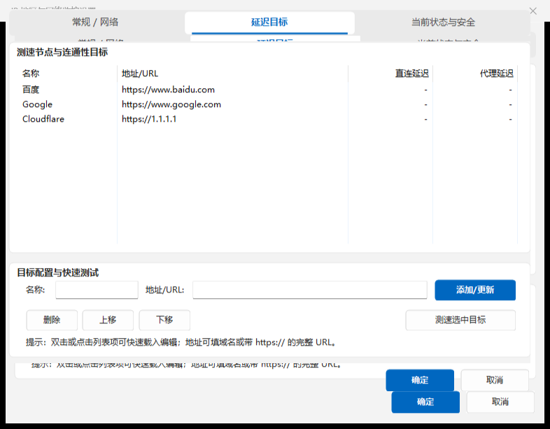
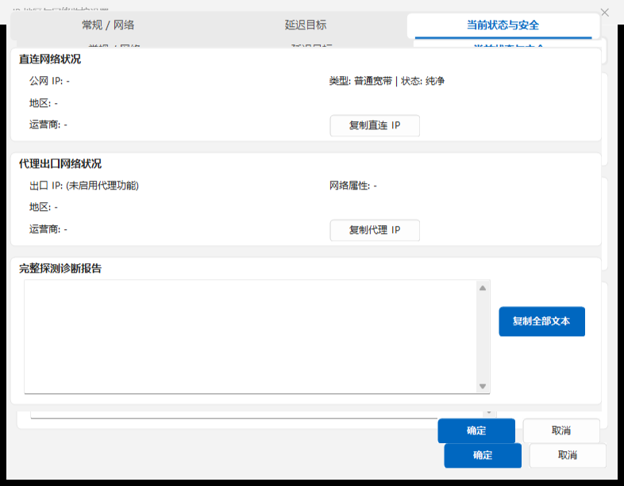

# IPRegionMon-For-TrafficMonitor

[简体中文](#简体中文) | [English](#english)

---

<a name="简体中文"></a>
# IPRegionMon-For-TrafficMonitor (简体中文)

一个专为 TrafficMonitor 设计的 IP 地区与网络监控插件，支持直连与代理出口双链路对比、纯净度检测、自定义延迟测速目标及 Windows 11 原生自绘现代卡片设置界面。

- 插件主类：`CIPRegionMon`
- 输出监控项：
  - 直：直连出口 IP / 地区
  - 代：代理出口 IP / 地区（可选）
- 支持版本：TrafficMonitor 插件 API v2+（兼容更高版本）
- 依赖要求：零外部第三方库依赖（仅使用 Windows 原生 WinHTTP、GDI+、DWM 及 MFC）

## 界面预览

### 任务栏展示效果


### 设置对话框（Windows 11 原生自绘现代卡片风格）

- **常规 / 网络 & 代理设置**
  

- **测速目标与延迟管理（表格宽度自适应）**
  

- **网络状况与安全报告（格式对齐与一键复制）**
  

### 悬浮提示（Tooltip）


---

## 功能特性

- **Windows 11 原生现代卡片 UI**：
  - 采用 Fluent 视觉调色板与自绘纯白圆角卡片布局（Card），界面呼吸感与留白比例大幅提升。
  - 顶栏采用自绘分段胶囊导航栏（`CModernTabBar`），支持鼠标悬停过渡与高亮指示线。
  - 按钮采用自绘圆角控件（`CModernButton`），主操作提供 Win11 强调蓝视觉反馈。
- **任务栏格式即时切换**：
  - 调整任务栏显示格式下拉选项时，系统即刻触发内存数据重格式化并更新任务栏，无需等待网络请求。
- **自动刷新动态倒计时**：
  - 常规设置面板状态行提供动态跳动的秒级倒计时，实时掌握下一次自动探测的时间点。
- **表格列宽自动伸缩**：
  - 延迟测速列表应用资源管理器主题（Explorer），列宽按比例自适应卡片实际宽度，在高分屏 DPI 下无横向滚动条。
- **多源高可用探测链与平滑降级（v2.1.1）**：
  - 内置多级权威公共 IP 探测备用池（`ip-api.com`、`api.ip.sb`、`ipwho.is`、`ipinfo.io`），首选源异常时自动链式降级尝试，防止单点故障。
  - 引入网络抖动平滑保留策略，当发生偶发性单次刷新失败时自动平滑复用历史健康缓存，避免任务栏频繁闪烁红字超时警告。
  - 放宽 HTTPS 代理中间人证书容错与自动跟踪重定向，无缝兼容内网代理与抓包工具。
- **链路独立探测与代理分流支持**：
  - 支持分别获取直连与代理出口的 IP、国家/地区/城市、ISP 运营商。
  - 代理出口默认使用国际化 API 接口（如 ip-api.com），避免由于分流规则导致出口 IP 识别错误。
- **纯净度与网络类型识别**：
  - 识别网络类型（普通宽带、蜂窝移动网络、数据中心/机房机房等）及安全状态（纯净原生、代理、VPN、Tor、恶意黑名单）。
- **动态延迟测速**：
  - 支持自由增删排测速目标，并可对选中目标进行单项即时测速。
- **全异步无感刷新**：
  - 网络探测全流程在后台线程池并发执行，采用双缓冲无锁更新，杜绝主程序 UI 冻结。
- **配置持久化安全**：
  - INI 文件保存，Unicode 与中文名称使用 `#u8:HEX` 十六进制编码，彻底规避本地代码页截断问题。
- **零外部依赖**：
  - 完全由 Windows 系统内置 API 构建，不引入额外的第三方 DLL 动态链接库。

---

## 安装方法

1. 在 [Releases](https://github.com/AHLLX/IPRegionMon-For-TrafficMonitor/releases) 页面下载对应架构的发布包（通常推荐 x64）。
2. 将压缩包内的 `IPRegionMon.dll` 解压至 TrafficMonitor 根目录下的 `plugins` 文件夹中。
3. 启动或重启 TrafficMonitor，在“插件管理”中勾选启用并配置要显示的项目。

---

## 使用说明

在任务栏监控项上右键选择“选项...”打开设置面板：
- **常规 / 网络**：
  - 设置任务栏显示格式与刷新间隔秒数。
  - 勾选“启用代理服务器”并填入 HTTP/SOCKS 代理地址（例如 `127.0.0.1:7890`）。
  - 点击“测试代理连通性”可在后台发起握手并回传耗时结果。
  - 点击“立即刷新”可立即应用当前所有改动并触发后台探测。
- **延迟目标**：
  - 选中列表项可载入并更新名称或目标 URL/域名。
  - 支持“测速选中目标”验证单点连通性。
- **当前状态与安全**：
  - 查看直连与代理链路的完整安全报告。
  - 支持单项复制直连 IP、代理 IP，或一键“复制全部文本”。

---

## 二次开发与编译

- **开发环境要求**：
  - Windows 10 / 11 操作系统。
  - Visual Studio 2022 或 Visual Studio 2026（MSVC 工具集 `v143` 或 `v145`）。
  - 安装“使用 C++ 的桌面开发”工作负载，并勾选“C++ MFC for x64/x86”。
  - Windows SDK 10.0.26100.0 或更高版本。
- **编译步骤**：
  1. 直接使用 Visual Studio 打开根目录下的 `IPRegionMon.vcxproj`。
  2. 选择 `Release | x64` 或 `Release | Win32` 配置进行生成。
  3. 亦可通过命令行执行 MSBuild：
     ```powershell
     & "C:\Program Files (x86)\Microsoft Visual Studio\18\BuildTools\MSBuild\Current\Bin\MSBuild.exe" IPRegionMon.vcxproj /p:Configuration=Release /p:Platform=x64
     ```
  4. 生成产物将位于 `Bin\x64\Release\plugins\IPRegionMon.dll`。

---

## 代码目录结构

```
./
├─ .agents/
│  └─ AGENTS.md                         # 开发规范与规则说明
├─ include/
│  └─ PluginInterface.h                 # TrafficMonitor 插件原生接口头文件
├─ images/                              # 说明文档真实界面截图
│  ├─ settings_dialog.png
│  ├─ settings_tab0.png
│  ├─ settings_tab1.png
│  └─ settings_tab2.png
├─ CustomDrawItem.cpp / CustomDrawItem.h # 任务栏自绘与展示逻辑
├─ DataManager.cpp / DataManager.h       # 数据缓存、配置管理、异步网络探测
├─ ModernUI.cpp / ModernUI.h             # Win11 Fluent 自绘卡片、导航条与按钮控件
├─ IPRegionMon.cpp / IPRegionMon.h       # 插件生命周期导出类
├─ OptionsDlg.cpp / OptionsDlg.h         # 现代卡片设置对话框及各子页面实现
├─ IPRegionMon.rc / resource.h           # 中英文资源脚本与控件 ID
├─ IPRegionMon.vcxproj                   # Visual Studio 2026/2022 工程文件
└─ README.md
```

---

## 许可证
- 本插件基于 MIT 协议开源。作者：HiTech_NinJa & 贡献者。

---

<a name="english"></a>
# IPRegionMon-For-TrafficMonitor (English)

[Back to Top / 返回顶部](#简体中文)

A modern IP region and network latency monitoring plugin designed for TrafficMonitor. Supports dual-link direct and proxy egress comparison, IP purity detection, customizable latency targets, and a native Windows 11 Fluent card-styled options dialog.

- Main Plugin Class: `CIPRegionMon`
- Output Items:
  - Direct: Direct exit IP / Location
  - Proxy: Proxy exit IP / Location (Optional)
- Supported Versions: TrafficMonitor Plugin API v2+
- Dependencies: Zero third-party dependencies (built exclusively on WinHTTP, GDI+, DWM, and MFC)

## Preview

### Taskbar Display


### Settings Dialog (Windows 11 Native Custom-Drawn Card Style)

- **General / Network & Proxy**
  

- **Latency Targets (Adaptive Column Widths)**
  

- **Current Status & Diagnostics (Aligned Layout & One-Click Copy)**
  

---

## Features

- **Windows 11 Native Modern Card UI**:
  - Utilizes Fluent palette and white rounded cards for clean visual hierarchy.
  - Custom-drawn segmented tab navigation (`CModernTabBar`) with smooth hover feedback and accent indicator lines.
  - Modern rounded button controls (`CModernButton`) featuring Win11 accent blue branding.
- **Instant Taskbar Format Updates**:
  - Changing display format instantly reformats the taskbar display text from memory without waiting for network requests.
- **Dynamic Refresh Countdown**:
  - Displays a real-time ticking countdown in the options dialog indicating when the next automatic refresh will occur.
- **Adaptive Column Widths**:
  - The latency targets ListView dynamically proportions column widths according to card dimensions with no horizontal scrollbars.
- **High Availability Multi-Source Fallback (v2.1.1)**:
  - Features multi-tiered fallback endpoints (`ip-api.com`, `api.ip.sb`, `ipwho.is`, `ipinfo.io`) with smooth caching to prevent transient timeouts and taskbar display drops during network fluctuations.
- **Dual Egress & Proxy Split-Routing Support**:
  - Concurrently queries public IP, location, and ISP for both direct and proxy links.
  - Uses internationalized endpoints for foreign queries to prevent split-routing misidentification.
- **Purity & Network Classification**:
  - Detects network types (Broadband, Cellular, Datacenter/Hosting) and security flags (Native, Proxy, VPN, Tor, Blacklist).
- **Asynchronous Non-Blocking Engine**:
  - Networking operations execute concurrently on worker threads using double buffering to ensure zero GUI freezes.
- **Safe INI Configuration**:
  - Preserves Unicode and Chinese characters using `#u8:HEX` encoding to eliminate character corruption across different code pages.
- **Zero Third-Party Dependencies**:
  - Fully self-contained implementation with no external runtime DLL requirements.

---

## Installation

1. Download the latest release from the [Releases](https://github.com/AHLLX/IPRegionMon-For-TrafficMonitor/releases) page (x64 recommended).
2. Extract `IPRegionMon.dll` into the `plugins` folder inside the TrafficMonitor directory.
3. Restart TrafficMonitor, enable the plugin in "Plugin Management", and select your desired items.

---

## License
- Licensed under the MIT License. Author: HiTech_NinJa & Contributors.
- The vendored TrafficMonitor interface retains its upstream Anti 996 License; see [interface provenance and license](include/README.md).
